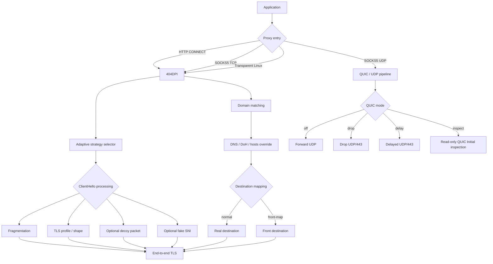

# 404DPI

<div align="center">


**Adaptive DPI-aware proxying for hostile, filtered, or unreliable networks.**

[](https://go.dev/)
[](https://github.com/batmanpri404DPI)
[](#how-it-works)
[](#socks5-and-doh)

**English** | [**فارسی**](https://github.com/specterog/404DPI/blob/main/readmefa.md) 

</div>

404DPI is a Go local proxy built around **adaptive TLS ClientHello
fragmentation with strategy learning**, plus SOCKS5, DNS-over-HTTPS, QUIC
handling, TLS-fingerprint controls, domain fronting, per-domain profiles, and
a local diagnostics/monitoring dashboard.

The design goal: **change the connection-establishment characteristics a
middlebox can inspect, without turning the proxy into a TLS
man-in-the-middle.** The destination TLS session stays end-to-end encrypted
the whole way through — 404DPI never terminates it.

---

## Table of contents

- [Why 404DPI](#why-404DPI)
- [How it works](#how-it-works)
- [Install](#install)
- [First run](#first-run)
- [Choosing a starting point](#choosing-a-starting-point)
- [Fragmentation strategies](#fragmentation-strategies)
- [Adaptive strategy learning](#adaptive-strategy-learning)
- [TLS fingerprint controls](#tls-fingerprint-controls)
- [Fake packets vs. fake SNI](#fake-packets-vs-fake-sni)
- [Domain fronting](#domain-fronting)
- [SOCKS5 and DNS-over-HTTPS](#socks5-and-dns-over-https)
- [QUIC](#quic)
- [Diagnostics, benchmarking, self-test](#diagnostics-benchmarking-self-test)
- [Configuration file](#configuration-file)
- [Blacklist](#blacklist)
- [Per-domain profiles](#per-domain-profiles)
- [Transparent mode (Linux only)](#transparent-mode-linux-only)
- [Upstream proxy chaining](#upstream-proxy-chaining)
- [Monitoring dashboard](#monitoring-dashboard)
- [Privacy](#privacy)
- [CLI reference](#cli-reference)
- [Known limitations](#known-limitations)
- [Architecture](#architecture)
- [Development](#development)
- [Security model](#security-model)
- [Responsible use](#responsible-use)
- [License](#license)

---

## Why 404DPI

Different networks interfere at different layers. A network may:

- reject a TCP stream when a TLS ClientHello exposes a target hostname in plain SNI;
- react differently to a fragmented vs. unfragmented ClientHello;
- fingerprint a connection from a stable TLS/JA3 shape;
- interfere with QUIC / UDP 443 specifically;
- serve unreliable or manipulated DNS;
- require a SOCKS5 interface rather than an HTTP CONNECT proxy;
- behave differently per destination (some CDNs are SNI-routed and picky about
  unusual traffic shapes, others aren't).

404DPI exposes several independent, composable controls instead of pretending
there's one universal bypass switch — and includes diagnostics/measurement
modes so you can observe what's actually happening on your network instead of
treating a successful TCP connect as proof of anything.

---

## How it works



404DPI never terminates the destination TLS (or QUIC) session to decide
whether a strategy worked. Adaptive success detection is deliberately
shallow — it looks at the first response record and treats a TLS Handshake
record (`0x16`) as a promising sign, an Alert (`0x15`) or anything else as
failure. Going further would mean acting as a TLS-terminating proxy, which
changes the security model (see [Security model](#security-model)).

---

## Install

### Clone and build (recommended — always works)

```bash
git clone https://github.com/specterog/404DPI
cd 404DPI

go mod tidy
go build -o 404DPI .          # 404DPI.exe on Windows
```

Run it:

```bash
404DPI -h        # 404DPI.exe -h on Windows
```

Development loop:

```bash
go test ./...
go vet ./...
go build ./...
404DPI -selftest
```

### `go install`

```bash
go install github.com/specterog/404DPI@latest
```

---

## First run

The default listener is an HTTP CONNECT proxy on `127.0.0.1:8881`. Nothing
else (SOCKS5, DoH, transparent mode) starts unless you ask for it.

```bash
404DPI
```

```text
HTTP proxy:  127.0.0.1:8881
HTTPS proxy: 127.0.0.1:8881
```

```bash
curl -x http://127.0.0.1:8881 https://example.com/
```

For SOCKS5 instead (or in addition):

```bash
404DPI -socks5 -socks5-host 127.0.0.1 -socks5-port 1080
```

```bash
curl --proxy socks5h://127.0.0.1:1080 https://example.com/
```

`socks5h` (not `socks5`) makes curl send the hostname to the proxy for
resolution instead of resolving it locally first — needed for DoH/hosts-file
overrides to actually apply, and for domain fronting and per-domain profiles
to see the hostname at all.

> **First-connection latency:** with `-adaptive` (on by default) and
> `-race-strategies` off (also default), a domain 404DPI has never seen
> before is tried sequentially through several strategies before falling
> back to a plain, unfragmented send as the last resort — each attempt has
> its own short timeout, so the very first connection to a new domain can
> take several seconds longer than a direct connection. Once a strategy
> succeeds, it's cached (see [Adaptive strategy learning](#adaptive-strategy-learning))
> and subsequent connections to that domain are fast. Pass `-race-strategies`
> if you'd rather spend more sockets/bandwidth up front for lower first-visit
> latency.

---

## Choosing a starting point

Four presets bundle common combinations. Explicit CLI flags always override
whatever a preset sets.

| Preset | `-preset` | Sets |
|---|---|---|
| Conservative baseline | `safe` | `sni` fragmentation, adaptive on, decoys/racing/shuffle off |
| Broad feature set | `aggressive` | `natural` fragmentation, adaptive, strategy racing, fragment jitter, DoH, QUIC drop, SOCKS5 |
| Timing-focused | `stealth` | `natural` fragmentation (randomized sizes/timing), adaptive, fragment jitter, QUIC drop |
| Proxy-oriented | `vpn-like` | SOCKS5, DoH, QUIC drop, adaptive |

```bash
404DPI -preset safe
404DPI -preset aggressive -fragment-jitter 30 -socks5-port 1081   # override an individual value
```

Effective precedence: **hard-coded defaults → config file → preset →
explicit CLI flags.**

If you don't know what your network needs yet, start here instead of
guessing:

```bash
404DPI -scan                                        # 1. see what's actually happening
404DPI -preset safe                                  # 2. conservative baseline
404DPI -fragment-method natural -adaptive             # 3. broaden if "safe" wasn't enough
404DPI -socks5 -doh                                   # 4. add SOCKS5/DoH once the app needs them
404DPI -tls-profile chrome -fake-packet               # 5. only then reach for more tactics
```

Enabling every feature at once adds latency, sockets, and harder-to-debug
failure modes without necessarily helping — [measure](#diagnostics-benchmarking-self-test)
rather than assume.

---

## Fragmentation strategies

| Method | What it does |
|---|---|
| `sni` | Split the ClientHello immediately before (default) or after the SNI extension |
| `natural` | Re-randomized TCP-like chunk sizes and timing, different every connection |
| `random` | Random chunk sizes within `-fragment-min`/`-fragment-max` |
| `multi` | Multi-stage deterministic chunking pattern |
| `none` | Send the ClientHello as a single, unfragmented TLS record |

```bash
404DPI -fragment-method natural -fragment-jitter 20
```

### Why `natural` exists

A fixed fragmentation pattern is itself a fingerprint. If every connection
splits the same way — say, always `12, 24, 8, 16, 32, 64` bytes — a
classifier can potentially identify the tool by that shape alone, even after
the original SNI-based interference is defeated. `natural` instead mixes
larger TCP-like writes with occasional smaller chunks and randomizes timing
per connection. `-benchmark` reports whether a given strategy's shape is
constant or actually varies run to run (see
[Diagnostics, benchmarking, self-test](#diagnostics-benchmarking-self-test)).

### Why `none` is in the list at all

Not every destination needs — or tolerates — fragmentation. Some CDN/WAF
edges are sensitive to unusual TLS record boundaries and may reject a
fragmented ClientHello even from a completely unblocked, ordinary site,
while accepting a normal one instantly. `none` is deliberately included as
the last strategy `-adaptive` falls back to, so a destination that never
needed bypassing in the first place still gets a real chance to just work
through the proxy instead of failing every time.

---

## Adaptive strategy learning

Enabled by default (`-adaptive`). Each per-domain cache entry tracks:

```text
attempts, successes, confidence = successes / attempts
```

```text
confidence >= 90%   trust the cached strategy, no racing
confidence 50–90%   race the cached strategy + one fallback
confidence < 50%    race up to 3 strategies from the escalation list
```

This avoids paying the full cost of trying every strategy against a
destination that already has a reliable one. The escalation order (from
`sni`/whatever `-fragment-method` set, through `natural`, `random`, `multi`,
a decoy-backed last resort, down to plain `none`) is fixed; adaptive mode
decides *how many* of them to try and in what confidence-gated order, not a
different order.

Persist the cache across restarts:

```bash
404DPI -strategy-cache-file strategy-cache.json    # this is also the default filename
```

---

## TLS fingerprint controls

### GREASE

```bash
404DPI -tls-grease
```

Adds a randomized GREASE cipher suite/extension value (RFC 8701-style), same
technique real browsers use to prevent ossification around a fixed
extension set.

### ECH GREASE

```bash
404DPI -ech-grease
```

Adds a correctly-shaped `encrypted_client_hello` extension (RFC 9849
§6.2). **This is not real ECH** — it does not encrypt or hide the real SNI,
which is still sent in the clear in the same ClientHello's `server_name`
extension. It exists purely so the ClientHello's extension *shape* matches
what a modern ECH-capable browser sends even when it has no real ECH config
for the destination, which is the common case and itself became a small
fingerprinting signal once most browsers started doing it.

### Padding

```bash
404DPI -tls-padding 1200
```

Pads the ClientHello to at least N bytes.

### Shuffle

```bash
404DPI -tls-shuffle
```

Randomizes cipher-suite and extension order per connection. Useful against
static fingerprint matching, but a *fully* randomized order is itself an
unusual, distinguishable shape — consider `-tls-profile` instead when a
consistent, real-browser-like shape matters more than randomness.

### Browser-like profiles

```bash
404DPI -tls-profile chrome     # or firefox / safari / edge
```

Reorders cipher suites, extensions, supported groups, signature algorithms,
and ALPN together as a coherent set matching one real browser's pattern,
rather than shuffling independently. Takes priority over `-tls-shuffle` when
both are set — a coherent order and a random order solve the same problem in
opposite ways, so only one applies.

---

## Fake packets vs. fake SNI

These are **not equivalent** and are documented separately on purpose.

### Fake packets (decoys)

```bash
404DPI -fake-packet -fake-packet-count 3 -fake-packet-ttl 4
```

Sends one or more separate ClientHello-shaped packets with a short TTL/hop
limit before the real fragmented ClientHello. Each decoy is built to expire
(TTL reaches zero) before it reaches the real destination, so it can
influence what an on-path observer sees without ever changing what the
destination actually receives. Multiple decoys at increasing TTL form a
"ladder" that can present different content to observers at different
distances along the path. IPv6 connections use the hop-limit field
automatically — no separate flag needed.

### Fake SNI

```bash
404DPI -fake-sni example.org
404DPI -fake-sni-pool "example.org,www.example.com,www.microsoft.com"   # rotate randomly
```

**This is different in kind from a decoy.** The modified ClientHello here is
the one that actually reaches the real destination server — not just what an
on-path DPI box sees. Since modern CDNs and shared hosting frequently route
certificates and backends by SNI, replacing `real.example` with
`cover.example` in-place can produce a certificate mismatch, the wrong
virtual host, an application-layer failure, or a completely different site
being served. 404DPI logs a startup warning when fake SNI is active.

**Prefer decoy packets when fragmentation alone is sufficient — use in-place
fake SNI only against a target you know doesn't route by SNI** (a
single-cert origin, most self-hosted servers).

---

## Domain fronting

```bash
404DPI -socks5 -front-map "real-target.example=front.example"
```

For a mapped HTTPS destination (port 443 only — there's no SNI to rewrite on
any other port), 404DPI changes **both** sides of the connection:

```text
application's intended target:  real-target.example  (unchanged)
wire SNI:                       front.example
TCP destination:                front.example's resolved IP
```

This is materially different from plain fake SNI above, which still dials
the real target's IP — domain fronting is for the harder case where the
target's *IP itself* is blocked, not just its SNI string.

### Finding a candidate pair

1. Identify the CDN/infrastructure actually serving the real target (e.g.
   inspect its certificate issuer or response headers).
2. Find another domain reachable on the *same* infrastructure.
3. `-front-map "real-target.example=front.example"`
4. Verify the **actual HTTP response**, not just that TLS completed:

   ```bash
   curl -v --resolve real-target.example:443:<front's IP> \
        https://real-target.example/ -H "Host: real-target.example"
   ```

   A successful TLS handshake alone proves nothing — the front's edge can
   complete a normal handshake with its own certificate and just serve its
   own homepage (or a CDN error page) instead of routing to the real target.

Domain fronting is inherently best-effort: many CDNs no longer allow
cross-customer routing at all, so a syntactically valid `real=front` pair
may simply not work. It changes the visible destination and outer SNI; it
does not make the connection invisible or encrypt anything that wasn't
already encrypted.

---

## SOCKS5 and DNS-over-HTTPS

```bash
404DPI -socks5 -socks5-host 127.0.0.1 -socks5-port 1080
```

Supports TCP `CONNECT`, UDP `ASSOCIATE` (for QUIC/UDP-443 handling and
SOCKS5-proxied DNS), and the same strategy/QUIC pipeline as the HTTP
listener.

### DNS-over-HTTPS

```bash
404DPI -doh -doh-server "https://1.1.1.1/dns-query"
```

Comma-separate several servers for failover — the first that answers
becomes sticky until it fails:

```bash
404DPI -doh -doh-server "https://1.1.1.1/dns-query,https://8.8.8.8/dns-query"
```

Includes positive and negative caching (`-doh-cache`) and a bounded resolver
cache.

### Static hosts overrides

```text
# hosts.txt
203.0.113.10 example.test
2001:db8::10 example6.test
```

```bash
404DPI -doh -hosts-file hosts.txt
```

Checked before any live DNS/DoH query — useful when DNS itself is
manipulated but you already know the real IP.

---

## QUIC

QUIC runs over UDP, so it needs its own path — TLS ClientHello fragmentation
doesn't apply. Handled in the SOCKS5 UDP relay via `-quic-mode`:

| Mode | Behavior |
|---|---|
| `off` (default) | Forward UDP/443 untouched |
| `drop` | Drop UDP/443, pushing QUIC-capable clients back onto TLS-over-TCP |
| `delay` | Forward after a randomized delay (`-quic-delay`, actual delay randomized between it and 2×) — keeps QUIC working but breaks its clean handshake timing |
| `inspect` | Decrypt just the QUIC v1 Initial packet's metadata (read-only), log the SNI, forward the **original, unmodified** bytes |

```bash
404DPI -socks5 -quic-mode drop            # or: -socks5 -block-quic (legacy alias)
404DPI -socks5 -quic-mode delay -quic-delay 100
404DPI -socks5 -quic-mode inspect
```

### What `inspect` actually does

QUIC v1 Initial packet protection uses a public, version-fixed salt and the
on-wire Destination Connection ID (RFC 9001 §5.2) — it exists to stop naive
middleboxes from choking on unrecognized traffic, not to provide
confidentiality. Any QUIC-aware DPI box (or Wireshark, with its built-in QUIC
decryption) can perform the exact same derivation. `inspect` does this to
recover the SNI for logging/visibility, then always forwards the datagram
exactly as it arrived:

```text
QUIC Initial → derive keys → remove header protection → AEAD open →
parse CRYPTO frame → extract SNI → log/metrics
                                          (original bytes forwarded unchanged)
```

Every failure mode (parse error, wrong version, authentication failure) is
fail-closed: if anything doesn't check out, the original packet is forwarded
untouched and nothing is logged. This implementation was independently
verified against the RFC 9001 Appendix A.1 test vectors and a full local
encrypt→decrypt round trip; see `quic_initial_test.go`.

---

## Diagnostics, benchmarking, self-test

### Scan

```bash
404DPI -scan
404DPI -scan -scan-domains "example.com,another.example"
```

Runs without starting the proxy. Compares plain TCP reachability, ordinary
TLS, SNI fragmentation, fake-SNI behavior, and local DNS vs. DoH for the
given domains — a measurement of *your* network, not a guarantee any
resulting strategy works everywhere.

### Benchmark

```bash
404DPI -benchmark -scan-domains "example.com,example.org"
```

Compares `direct`, `sni`, `natural`, `random`, `multi`, and `sni+fake-packet`
against each domain, reporting success rate, median/max latency, JA3
fingerprint, and whether the fragmentation shape stayed constant (a
liability — see [`natural`](#why-natural-exists)) or actually varied across
runs. This measures locally observable properties; it is **not** a real
adversarial-DPI test, since there's no actual censor/classifier in the loop.

### Self-test

```bash
404DPI -selftest
```

Exits 0 if local capability checks (TCP connectivity, DNS/DoH, IPv6,
TTL/hop-limit socket options, ClientHello parsing, transparent-mode support)
all pass — suitable for CI/scripts.

### Fuzzing the ClientHello parser

```bash
go test ./...
go test -fuzz=FuzzParseClientHello
```

---

## Configuration file

A small, dependency-free `key = value` format:

```ini
host = 127.0.0.1
port = 8881

fragment-method = natural
fragment-min = 10
fragment-max = 60
fragment-delay = 2
fragment-jitter = 15
adaptive = true

socks5 = true
socks5-host = 127.0.0.1
socks5-port = 1080

doh = true
doh-server = https://1.1.1.1/dns-query
doh-cache = true

quic-mode = drop

fake-packet = true
fake-packet-ttl = 4
fake-packet-count = 2

tls-grease = true
ech-grease = true
tls-profile = chrome

stats-http = true
stats-port = 9090
```

```bash
404DPI -config 404DPI.conf
```

Unrecognized/malformed lines are ignored rather than treated as a fatal
error. Precedence, when combined with a preset or CLI flags, is: defaults →
config file → preset → CLI flags.

---

## Blacklist

A plain-text, one-domain-per-line file listing the destinations that **need
the bypass** (fragmentation etc.). Connections to listed domains get the
bypass; everything else is passed straight through untouched, and nothing is
ever refused with a 403. With `-no-blacklist` *every* destination gets the
bypass. The "Bypassed"/"Direct" counters in the stats show how many
connections went each way.

```bash
cp blacklist.txt.example blacklist.txt
404DPI -blacklist blacklist.txt
```

`blacklist.txt.example` in this repository is a sample list of domains that
are commonly blocked — adapt it to your own network. Populate `blacklist.txt` yourself with whatever's relevant to your own
network; comments (`#`) and blank lines are fine.

- `-no-blacklist` — disable blacklist handling entirely.
- `-autoblacklist` — instead of reading a static list, learn which domains
  need bypassing from repeated connection failures, and persist what it
  learns back into the same file.
- `-domain-matching strict` (default) — exact domain match only.
- `-domain-matching loose` — substring match (a blocked entry matches any
  domain containing it as a substring) — broader, but can over-match.

> **Privacy:** a populated blacklist can itself reveal information about the
> network/deployment it was built for. Avoid committing a private or
> organization-specific `blacklist.txt` unless that's intentional — see
> [Privacy](#privacy) for how domain names are (by default) redacted in
> everything the proxy *itself* writes to disk, which is a separate concern
> from a blacklist file you maintain yourself.

---

## Per-domain profiles

Override global fragmentation behavior for specific domains inside the
config file:

```ini
fragment-method = natural
fragment-min = 10
fragment-max = 60
adaptive = true

[profile: example.com]
fragment-method = sni
fragment-min = 8
fragment-max = 24
fragment-delay = 3

[profile: *.example.net]
fragment-method = random
fragment-min = 4
fragment-max = 12
split-after-sni = true
```

Supported overrides: `fragment-method`, `fragment-min`, `fragment-max`,
`fragment-delay`, `fake-sni`, `split-after-sni`. A `*.` prefix matches the
base domain and its subdomains.

### Hot-reload on Linux

```bash
kill -HUP "$(pidof 404DPI)"
```

Reloads only the `[profile: ...]` sections. Listener addresses/ports, DoH
servers, and other global settings still need a restart.

---

## Transparent mode (Linux only)

Redirect traffic to 404DPI without configuring every application:

```bash
sudo iptables -t nat -A OUTPUT -p tcp --dport 443 -j REDIRECT --to-port 12345
sudo iptables -t nat -A OUTPUT -p tcp --dport 80  -j REDIRECT --to-port 12345

sudo 404DPI -transparent -transparent-port 12345
```

Recovers the original destination via Linux `SO_ORIGINAL_DST`, then runs it
through the same processing pipeline as the regular listeners.

**This is Linux-only.** There's no WinDivert-based (Windows) or pf/divert-socket
(macOS) kernel packet interception in this project — both would need
platform-specific, driver-level code this project doesn't attempt to ship
untested. On Windows or macOS, use SOCKS5 (or the HTTP CONNECT proxy) and
configure your system/application proxy settings instead; requesting
`-transparent` there logs a warning and does nothing.

---

## Upstream proxy chaining

Connect through another HTTP or SOCKS5 proxy instead of dialing destinations
directly:

```bash
404DPI -out-host 127.0.0.1 -out-port 1081 -out-type socks5 \
         -out-username USER -out-password PASSWORD
```

Independent of the local HTTP/SOCKS5 listener you connect your applications to.

---

## Monitoring dashboard

```bash
404DPI -stats-http -stats-port 9090
```

Binds to `127.0.0.1` only, regardless of `-host`.

```text
GET /         read-only HTML dashboard (embedded, no build step, no CDN/JS framework)
GET /stats    JSON statistics
GET /metrics  Prometheus-compatible metrics
```

The dashboard shows live connection counters, current configuration, the
per-domain adaptive-strategy cache with confidence, and recent QUIC SNI
inspection activity when `-quic-mode inspect` is on. It's intentionally
**read-only** — nothing on the page can change proxy behavior, since a
control surface that could would need real authentication to be safe even on
localhost.

Prometheus metric names: `dpi_connections_total`, `dpi_connections_allowed`,
`dpi_connections_blocked`, `dpi_connections_error`, `dpi_connections_active`,
`dpi_bytes_in_total`, `dpi_bytes_out_total`, `dpi_strategy_attempts_total`,
`dpi_strategy_successes_total` (the last two labeled by `domain`/`strategy`).

---

## Privacy

Domain names written to **anything persistent** — access/error logs, the
auto-blacklist file, the strategy cache, QUIC SNI logging — are, by default,
replaced with a deterministic one-way token (truncated SHA-256) instead of
the real domain. The token is deterministic specifically so the adaptive
cache and auto-blacklist keep matching correctly across restarts; only the
human-readability of the file on disk is what's traded away.

```bash
404DPI -log-domains
```

turns this off and stores real domain names in plaintext instead — only do
this on a machine where that browsing history sitting in local files is
acceptable to you.

---

## CLI reference

```bash
404DPI -h    # authoritative, always matches your actual build
```

| Flag | Purpose |
|---|---|
| `-config path` | Load a config file |
| `-preset name` | `safe` / `aggressive` / `stealth` / `vpn-like` |
| `-host` / `-port` | HTTP proxy listener (default `127.0.0.1:8881`) |
| `-auth-username` / `-auth-password` | Require Proxy-Authorization on the HTTP/SOCKS5 listener itself |
| `-out-host` / `-out-port` / `-out-type` | Upstream proxy (`http`/`socks5`) to chain through |
| `-out-username` / `-out-password` | Upstream proxy credentials |
| `-blacklist path` | Blacklist file (default `blacklist.txt`) |
| `-no-blacklist` | Disable blacklist handling |
| `-autoblacklist` | Learn blocked domains from failures instead of a static list |
| `-domain-matching` | `strict` (default) / `loose` (substring) |
| `-fragment-method` | `sni` / `natural` / `random` / `multi` / `none` |
| `-fragment-min` / `-fragment-max` | Fragment size bounds (bytes) |
| `-fragment-delay` | Delay between fragments (ms) |
| `-fragment-jitter` | Extra random 0..N ms added per fragment |
| `-split-before-sni` / `-split-after-sni` | Split point relative to the SNI extension |
| `-adaptive` | Learn a working strategy per domain (default on) |
| `-race-strategies` | Try several strategies in parallel instead of sequentially |
| `-fake-packet` / `-fake-packet-ttl` / `-fake-packet-count` | Short-TTL decoy ClientHello(s) |
| `-fake-sni value` / `-fake-sni-pool list` | Replace the real outgoing SNI (see [warning](#fake-packets-vs-fake-sni)) |
| `-front-map real=front[,real2=front2...]` | Domain fronting |
| `-tls-grease` / `-ech-grease` | GREASE extensions |
| `-tls-padding N` | Pad the ClientHello |
| `-tls-shuffle` | Randomize cipher/extension order |
| `-tls-profile` | `chrome` / `firefox` / `safari` / `edge` |
| `-socks5` / `-socks5-host` / `-socks5-port` | SOCKS5 listener |
| `-doh` / `-doh-server` / `-doh-cache` | DNS-over-HTTPS |
| `-hosts-file path` | Static DNS overrides |
| `-quic-mode` | `off` / `drop` / `delay` / `inspect` |
| `-block-quic` | Legacy alias for `-quic-mode drop` |
| `-quic-delay` | Base delay (ms) for `-quic-mode delay` |
| `-http-obfuscate` | Mangle plain-HTTP Host headers |
| `-ttl` | Outgoing IPv4 TTL (0 = OS default; IPv6 hop limit follows automatically) |
| `-keep-alive` | TCP keep-alive |
| `-buffer-size` | Relay buffer size (bytes) |
| `-timeout` | Connection timeout (seconds) |
| `-transparent` / `-transparent-host` / `-transparent-port` | Linux-only transparent mode |
| `-tcp-fastopen` / `-tcp-mss` | Linux-only low-level socket tuning |
| `-strategy-cache-file path` | Persist the adaptive cache (default `strategy-cache.json`) |
| `-stats-http` / `-stats-port` | Local dashboard/JSON/Prometheus server |
| `-max-connections N` | Concurrent connection cap (0 = unlimited) |
| `-scan` / `-scan-domains` | Run diagnostics and exit |
| `-benchmark` | Run the fragmentation benchmark and exit |
| `-selftest` | Run environment capability checks and exit |
| `-log-access path` / `-log-error path` | Log files |
| `-log-domains` | Store real domain names instead of tokens (see [Privacy](#privacy)) |
| `-quiet` (`-q` shorthand on Windows) | Disable the live console stats display |

---

## Known limitations

- **No universal guarantee.** A strategy that works on one network can fail
  on another; there is no single bypass that works everywhere.
- **No full TLS termination**, by design — adaptive success detection can't
  validate the complete application response without becoming a
  TLS-terminating proxy, which would change the security model.
- **Options that rewrite the ClientHello break real TLS connections.**
  `-fake-sni`, `-fake-sni-pool`, `-tls-profile`, `-tls-shuffle`, `-tls-grease`,
  `-ech-grease` and `-tls-padding` change bytes the application already
  hashed into its handshake transcript, and 404DPI relays that handshake
  rather than terminating it. The server then derives different keys and the
  client aborts (`bad record MAC`). Only plain fragmentation
  (`-fragment-method`) keeps the bytes intact. These options are only
  meaningful for `-scan`/`-benchmark` style probing, where 404DPI itself is
  the TLS client, and no preset enables them.
- **`-fake-packet` (Linux + root only).** The decoy is forged with a raw
  socket using the connection's real sequence numbers (read via
  `TCP_REPAIR`), so it is never retransmitted with a different TTL. It needs
  `CAP_NET_RAW` + `CAP_NET_ADMIN` and is hidden from the server by
  `-fake-method` (`ttl`, `badsum`, `badseq`, `md5`, combinable). `ttl` needs
  `-fake-packet-ttl` to be larger than the hops up to the DPI box and
  smaller than the hops to the server - a value that is too high delivers the
  decoy to the server and breaks the connection. Without the privileges it
  logs a warning and carries on without decoys. Never enabled automatically.
- **`-front-map` (domain fronting)** terminates the application's TLS
  locally with a name-constrained local CA (`-front-ca-dir`; import
  `ca.pem` into the trust store of the application that should use it) and
  opens its own TLS connection to the front with SNI=front and the original
  Host header. It only helps if the front's CDN still routes by Host
  header, which most large CDNs no longer allow. Only HTTP/1.1 is spoken on
  both legs.
- **TTL decoys depend on path topology** - only useful if the relevant
  observer sits on the path before the packet's TTL expires.
- **QUIC `drop`/`delay`/`inspect` operate in the SOCKS5 UDP relay**, not as
  a kernel-level firewall rule — they only see traffic actually proxied
  through it.
- **Transparent mode is Linux-only**; see
  [Transparent mode](#transparent-mode-linux-only) for why Windows/macOS
  aren't attempted here.
- **No raw-socket / invalid-checksum packet tricks.** Some other DPI tools
  construct packets with deliberately invalid checksums to desynchronize a
  passive observer's TCP reassembly from the real destination's. This
  project doesn't implement that — it needs more invasive, harder-to-verify
  packet construction and substantially more platform-specific testing than
  everything else here.
- **No post-handshake traffic-shape naturalization.** Fragmentation and
  timing variation apply to the ClientHello; ongoing application traffic
  after the handshake isn't reshaped.
- **No active-probing defense.** This is a client-side proxy; it doesn't
  provide server-side defense against a censor actively probing a
  destination it's suspicious of.

---

## Architecture

```text
main.go                      — thin entry point, calls into the package below
internal/dpiproxy/
  config.go, flags.go        — configuration, CLI flags, presets, profiles
  run.go                     — proxy lifecycle, HTTP CONNECT listener, blacklist
  strategy.go                — fragmentation strategy selection, racing, escalation
  adaptive_stats.go          — per-domain attempts/successes/confidence
  fragshape.go                — chunking algorithms (random/multi/natural)
  tls_clienthello.go          — hand-rolled ClientHello parser/serializer
  tlsprofiles.go              — browser-like reordering (chrome/firefox/safari/edge)
  fingerprint.go              — JA3 computation
  fakepacket.go                — short-TTL decoy packets, IPv4/IPv6
  domainfront.go               — domain fronting dial/SNI override
  doh.go                       — DNS-over-HTTPS resolver, cache, failover
  socks5.go                    — SOCKS5 CONNECT + UDP ASSOCIATE
  quic_initial.go               — QUIC v1 Initial decrypt (RFC 9001), read-only inspect
  transparent*.go               — Linux SO_ORIGINAL_DST (platform-guarded)
  sockopts*.go                  — TCP Fast Open / MSS (platform-guarded)
  privacy.go                    — domain-token redaction for persisted state
  persistence.go                — strategy cache load/save
  benchmark.go, selftest.go, diagnose.go  — measurement/diagnostic modes
  statshttp.go, webpanel.go     — JSON/Prometheus/dashboard HTTP server
```

`main.go` at the repository root is intentionally a few lines — everything
else lives in the internal package.

---

## Development

```bash
go mod tidy
go test ./...
go vet ./...
go build ./...
404DPI -selftest
```

Static review of a diff is not the same thing as a real build or a
real-network interoperability test — actually run the commands above (and
`-scan`/`-benchmark` against your target network) before treating a change
as verified.

When changing a low-level networking/protocol feature, please include:

1. a focused implementation;
2. unit tests for parsers and protocol transformations, and round-trip tests
   against known values where a real spec exists (see `quic_initial_test.go`
   for the pattern);
3. platform guards (`//go:build`) where a feature is OS-specific;
4. documentation for any new flag/config key;
5. an explicit statement of what was and wasn't actually tested — "should
   work" and "verified against RFC test vectors on real hardware" are very
   different claims.

---

## Security model

404DPI is a **transport/proxy manipulation tool** — not a VPN, not an
anonymity system. It does not provide anonymity, end-to-end identity hiding,
protection against a compromised endpoint or a malicious upstream proxy, or
protection against application-layer tracking or all forms of traffic
analysis.

Its actual, narrower security property:

> Preserve the application's end-to-end encrypted connection to its intended
> destination, while changing selected connection-establishment
> characteristics that a middlebox along the path might inspect or disrupt.

Evaluate your own network, application, and threat model separately — this
tool is one input to that, not a substitute for it.

---

## Responsible use

Intended for legitimate network diagnostics, research, interoperability
testing, privacy-preserving connectivity, and use on networks you're
authorized to operate this kind of software on. Do not use it to bypass
access controls on systems you don't own or don't have permission to access.
